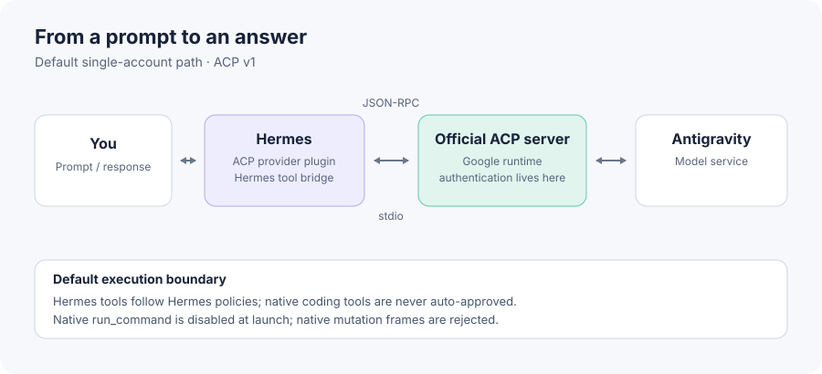

# hermes-antigravity-acp

[](https://github.com/rhgo1749/hermes-antigravity-acp/releases/latest)
[](https://github.com/rhgo1749/hermes-antigravity-acp/actions/workflows/ci.yml)
[](LICENSE)

Use Google's **official Antigravity ACP server** as a model provider for
[Hermes Agent](https://github.com/NousResearch/hermes-agent), through standard
ACP v1 JSON-RPC over stdio. No Hermes Core patch, TUI scraping, or private
transport reimplementation is required.

The default **Parked-MCP** engine keeps tool execution in Hermes while
preserving the official ACP session. The alternative Replay engine remains
selectable. This is an independent project, not affiliated with Google.
It neither redistributes Google's proprietary binaries nor extracts, copies,
or emulates Google OAuth tokens.



- **Hermes-owned tools:** native execution is not auto-approved; the default
  engine parks MCP tool calls until Hermes returns their results.
- **Live model discovery:** server-advertised model IDs, no curated fallback list.
- **Session continuity:** scoped to the conversation, including delegated children.
- **Cross-platform installer:** publisher-pinned official server downloads,
  explicit lifecycle management, and no self-update.
- **One provider package:** Parked-MCP by default, Replay by explicit opt-in.

## Status at a glance

| Topic | Status |
|---|---|
| Standalone | [v0.9.3](https://github.com/rhgo1749/hermes-antigravity-acp/releases/tag/v0.9.3), ACP server 1.5.2 |
| Hermes | `>=0.21.6` CI-proven floor; stable baseline v0.23.4 |
| OS evidence | Ubuntu 24.04 x86_64 dedicated-UID clean room; Linux aarch64, macOS arm64, Windows x64/arm64 native hosted-CI lifecycle evidence |
| Catalog (checked 2026-11-27) | Listed for Linux at 0.8.0; see [official entry](https://github.com/NousResearch/hermes-agent/blob/main/plugin-catalog/antigravity-acp-provider.yaml) for the current pin |
| Download | Explicit install only, HTTPS from `dl.google.com`, publisher SHA-256 verified before extraction. No self-update; no redistribution. |
| Live validation | Credential-free CI does not validate authentication or real inference. An earlier supervised canary returned a response; no published end-to-end authentication or inference result for this release. |
| Usage | Both engines always return `completion.usage=None`; `/quota` is unavailable. |

## 5-minute Quick Start (single account, credential-free)

Requires Hermes `>=0.21.6`, Python 3, Git and a supported target.
No Docker, sudo, account mux, or Hermes fork is needed.

On Linux or macOS:

```bash
git clone --branch v0.9.3 https://github.com/rhgo1749/hermes-antigravity-acp.git
cd hermes-antigravity-acp
python3 scripts/install_acp.py install
python3 scripts/install_acp.py status
python3 scripts/install_acp.py verify
```

On Windows, clone the same tag and run [install-windows.cmd](install-windows.cmd)
from the checkout (double-click or run it in Command Prompt). It uses Hermes'
Python when available, otherwise the Windows Python launcher.

Start or reload Hermes and select **Antigravity ACP** in its provider/model
selector. Optional provider admission validation from the checkout:

```bash
hermes plugins validate hermes-plugin/antigravity-acp --install-deps
```

**What is verified:** the hosted clean-room runs the install and handshake
route (see [historical evidence](docs/official-server-1.4.4-clean-room-e2e-2026-11-07.md)).
There is no published end-to-end authentication or inference result for v0.9.3.

**Harness behavior (observable, ours):** `verify` requires no credentials, its
own code reads no credential stores, and the probe sends exactly one
unauthenticated `initialize` with no auth method, no prompt, and no credential material.
**Vendor behavior (not observed, no claim):** `verify` starts Google's
proprietary server as a child process with the caller's environment and no filesystem
sandbox, so what that binary reads or writes under your account is not observable
from this repository — it is neither claimed nor excluded here; see the vendor
attribution in `docs/data-and-permissions.md`.

Authentication and the first model call are outside this Quick Start.
Read [the terms and authentication boundary](#important-personal-antigravity-oauth-and-third-party-harnesses)
before signing in. See [full lifecycle and profile options](docs/quick-start.md).

## Installation paths: standalone or catalog

**Standalone:** the combined installer manages both the server and provider.
It targets the selected Hermes home by default; use `--all-profiles` or
`--hermes-home` only when needed. Update and delete via the same installer.
It refuses catalog-managed or provenance-unknown provider directories;
a provider refusal does not roll back a completed server install.

**Catalog path (Linux) — provider and server are separate.**

1. Run `hermes plugins install antigravity-acp-provider`. This step installs no Google binary.
2. Read the [official catalog entry](https://github.com/NousResearch/hermes-agent/blob/main/plugin-catalog/antigravity-acp-provider.yaml)
   and check out this repository at that entry's exact `sha` (not `main`).
   Run `python3 scripts/install_official.py` from that checkout.

Do not use `scripts/install_acp.py install` for this step: the combined installer
would attempt to manage catalog-owned provider files. Use Hermes plugin
update/remove for those files. The catalog 0.8.0 and standalone 0.9.3 pins
both use ACP server 1.5.2; always follow the catalog SHA rather than guessing.

The server-only installer supports `--status`, `--verify`, and `--uninstall`.
It leaves provider files untouched. All downloads verify Google's publisher
SHA-256 before opening or extracting the archive. See the
[ACP Registry entry](https://github.com/agentclientprotocol/registry/tree/main/antigravity-acp)
and [installer lifecycle](docs/quick-start.md).

## Important: personal Antigravity OAuth and third-party harnesses

Google's [Antigravity Terms](https://antigravity.google/terms) restrict
third-party use of personal Antigravity OAuth and describe account suspension
or termination for breaches. The [FAQ](https://www.antigravity.google/docs/faq/)
recommends Gemini Enterprise or Google AI Studio API keys for third-party
coding agents. Organizational access requires the applicable administrator grant.

The official ACP server advertising an auth method does **not** prove that
the method is permitted in a third-party client. Do not treat a personal
subscription as a third-party API substitute or use account rotation to evade
quotas. This project does not automate personal OAuth or hold Google credentials.

### Attended official-server login

Sign in only through Google's official runtime using a route permitted by
your account's terms. The included attended login driver sends ACP
`initialize` and `authenticate` only, requires confirmation and validates
the installer-managed binary. A successful authenticate response is not proof
of model access. See [terms and licensing](docs/terms-and-licensing.md) and
[authentication troubleshooting](docs/troubleshooting.md).

## Hermes provider plugin

### Engines: Parked-MCP (default) and Replay (selectable)

| Provider ID | Engine | Registration |
|---|---|---|
| `antigravity-acp` | Parked-MCP | Default since 0.9.0 |
| `antigravity-acp-replay` | Replay | Explicit opt-in |

The Parked-MCP engine was authored by [Nanako0129](https://github.com/Nanako0129)
(MIT licensed) and integrated as the default in v0.9.0. It exposes a per-session
loopback Streamable-HTTP MCP endpoint that parks requests for Hermes to execute.
The Replay engine is not deprecated. Existing `antigravity-acp-mcp` and
`agy-mcp` IDs resolve as aliases of the default provider.

To enable Replay, set the following in the installed provider's
`launch_config.json` under the selected Hermes home's
`plugins/model-providers/antigravity-acp/`, retaining existing settings:

```json
{"extra_providers": ["antigravity-acp-replay"]}
```

Restart Hermes, then select the Replay provider. Engine choice is explicit;
there is no automatic fallback or cross-engine retry of side-effecting tools.
The default connection resolves the official launcher and launches an official
server child from it for each ACP session or attempt.

### Model listing is live-only

Model discovery uses server-advertised IDs; no guessed catalog is shipped.
Availability depends on the account, engine, and server. See
[provider runtime](docs/provider-runtime.md) and [Parked-MCP contracts](docs/design-c-opt-in.md).

## Data, permissions, and processes (summary)

- **Runtime data to Google flows through the official server.** Hermes prompts,
  tool payloads, session references and attached media references reach the child
  over stdio; every model/protocol request that this runtime sends onward to Google
  originates from that Google-distributed binary. The plugin does not directly
  connect to Google's model service. Parked-MCP binds an authenticated HTTP
  endpoint to `127.0.0.1`. Distinctly, the standalone installer fetches the pinned
  server archive over HTTPS from `dl.google.com` during an explicit install command.
  Other networking inside the proprietary binary is not observed or bounded here.
- **Environment:** the ACP child receives a minimum-enumerated environment
  allowlist carrying no ambient provider API keys, gateway tokens, or session
  identity variables, plus a deliberately synthesized bounded set of `ACP_MUX_*`
  routing/session metadata (not Google credentials). The vendor child runs under
  the invoking account with no filesystem sandbox.
- **Tools:** native `run_command` is disabled at launch; native mutation/command
  permission requests are rejected. Hermes tools follow Hermes policy and approvals.
  Replay reads are policy-guarded; native writes are denied.
- **State:** Replay checkpoints include native session IDs for resume; telemetry
  uses hashes. See the data disclosure for permissions, TTLs and cache scope.
- **Processes:** the default topology launches one official server child per ACP
  session or attempt, so concurrency/retries can yield more than one child over a
  Hermes process lifetime. A healthy child is parked after its session ends and
  reused by the next session with matching affinity and launch identity (120s TTL).
  Failed children are terminated; active and parked children have cleanup paths.
  Not daemonized services.
- **Usage:** since v0.9.2, both engines always return `completion.usage=None`.
  Prompt-result consumption is discarded; `usage_update` observations never populate
  request usage buckets. Replay exposes non-billing `context_occupancy` and
  `turn_consumption` and persists frame sums; Parked-MCP exposes unverified
  `antigravity_usage_observations` without persisting those observations.
  Core records no per-model usage rows; zero totals are not zero consumption.
  Existing contaminated occupancy anchors can survive gateway restarts.
  Billed tokens, context occupancy and consumption differ; `/quota` is unavailable.

See [data and permissions](docs/data-and-permissions.md) and
[usage telemetry](docs/acp-usage-telemetry.md) for exact contracts.

## OS support and verification tiers

| Platform | Evidence |
|---|---|
| Linux x86_64 (Ubuntu 24.04) | Dedicated OS UID, real-binary clean-room lifecycle |
| Linux aarch64 | Native hosted CI |
| macOS arm64 | Native hosted CI |
| Windows x64 / arm64 | Native hosted CI |

Historical [clean-room evidence](docs/official-server-1.4.4-clean-room-e2e-2026-11-07.md):
the earlier shared-UID container lifecycle was NOT EXECUTED as clean-room
acceptance evidence; an environment scrub does not establish a separate OS UID.

The [v0.9.3 release gate](https://github.com/rhgo1749/hermes-antigravity-acp/actions/runs/45870027033)
passed all five platforms on the exact release SHA. Hosted checks do not prove
auth, live model discovery, real inference or support for other architectures.

The registry pins are checked by tests; that credential-free `fake-acp`
registry/regression job performs no live feed fetch, no authentication, and no
real-binary execution. Real-binary execution in CI belongs to the dedicated-UID
`acp-clean-room` job described above and to the platform install lanes.

### CI tier structure (issue #9)

`CI gate` is the required verdict; release dispatch additionally requires an
exact-SHA Release gate. See [verification matrix](docs/release-verification-matrix.md),
[CI scope policy](docs/ci-main-push-scope.md) and [evidence ledger](docs/clean-env-e2e-smoke.md).

### Four distinct evidence classes (never conflated)

Authentication, ACP initialize, model discovery and real model inference are
separate evidence classes. A credential-free handshake proves neither auth
nor inference. Live canaries require separate approval; see [live canary](docs/live-canary.md).

## Antigravity ACP MUX (optional, preview)

The optional MUX is excluded from the default install and routes configured
accounts only when explicitly selected. Review applicable terms; it is not
a quota-evasion mechanism. See [MUX packaging](docs/mux-packaging.md).

## Troubleshooting

Run `python3 scripts/install_acp.py status` first for standalone installs.
See [troubleshooting](docs/troubleshooting.md) for missing launchers, auth,
version mismatches, tampered downloads, profile conflicts and gateway failures.

- [Hermes compatibility](docs/hermes-compatibility.md) · [ACP path contract](docs/acp-path-contract.md)
- [Server protocol notes](docs/official-server-1.2.1-contract.md) · [model surfaces](docs/official-server-1.4.4-model-surface.md)
- [Web research bridge](docs/web-research-bridge.md)

## License

Project code is MIT licensed. Google's official binaries and services remain
subject to Google's licenses and terms. See [LICENSE](LICENSE),
[NOTICE.md](NOTICE.md) and [terms and licensing](docs/terms-and-licensing.md)
for non-affiliation and Hermes Agent (Nous Research) attribution.
