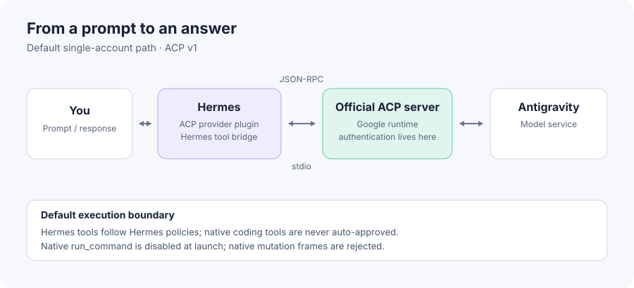

# hermes-antigravity-acp

Use Google's **official Antigravity ACP server** as a standard ACP v1 agent
backend for Hermes, without scraping the Antigravity TUI or reimplementing its
private transport.

This repository does **not** redistribute Google's proprietary binaries and does
**not** extract, copy, or emulate Google OAuth tokens. The installer downloads
the official `antigravity-acp` distribution directly from Google's CDN using
the version and platform mapping published in the Agent Client Protocol
Registry. This is an independent project and is not affiliated with Google;
see `NOTICE.md`.

Google now publishes a standalone Antigravity ACP server (`agy_acp_server`)
that speaks newline-delimited JSON-RPC over stdio, so an ACP client can
integrate the Antigravity agent runtime through a structured protocol instead
of a PTY, TUI parser, or a custom `agy --input-format stream-json` bridge.



The provider communicates with the official server over ACP JSON-RPC via stdio.
Hermes tool calls follow Hermes policies and approvals. The ACP server's native
coding tools are never auto-approved: native `run_command` is disabled at
session launch and native file-mutation or command permission frames are
answered with the server's own reject option, so shell and file work runs
through Hermes' own approval-gated terminal and file tools.

## Status at a glance (evidence-backed, checked 2026-11-08)

| Topic | Current status |
|---|---|
| Hermes version | `plugin.yaml` declares `requires_hermes: ">=0.21.6"` — a CI-proven floor re-run on every change (`catalog-floor-gate`); the latest upstream Hermes release is `v0.23.1`. |
| OS support | **Ubuntu 24.04 x86_64** is the only OS with real-binary, dedicated-OS-UID clean-room execution evidence (GitHub-hosted CI; see [OS support and verification tiers](#os-support-and-verification-tiers)). **Windows x64 and Windows arm64** have real-binary hosted-CI execution evidence (actual installer + provider registration + unauthenticated ACP `initialize` on `windows-2022`/`windows-11-arm` runners) — one tier below clean-room, still executed. **Linux aarch64 and macOS arm64** are registry-pinned with publisher digests but **NOT RUN** — pinned-only, not executed support. |
| Public plugin catalog | **Not registered yet.** `hermes plugins install antigravity-acp-provider` does not resolve today (upstream `plugin-catalog/` contains no entry for this provider as of 2026-11-12). The catalog submission PR ([NousResearch/hermes-agent#153182](https://github.com/NousResearch/hermes-agent/pull/153182)) is open and pending upstream review; registration is not approved or merged as of this writing. The only currently reproducible install path is the standalone installer below. |
| Official server binary | Pinned `1.4.4`, fetched **only during an explicit install command** over HTTPS from `dl.google.com`; the publisher-pinned SHA-256 digest is verified **before** the archive is opened, extracted, or installed. No self-update; no redistribution. |
| Authentication & first model call | Credential-free CI does not validate authentication or real inference. A supervised one-prompt canary produced a real response on an earlier client version; the current release has not been verified end-to-end in that same way. This observation does not establish terms compliance for other uses. |
| `/quota` | Unavailable / unsupported: the official server reports no billed request tokens. Since v0.7.9, `completion.usage` is populated **only** when the server itself supplies a valid per-turn usage payload — the official server currently never does, so completions carry `completion.usage=None` and Hermes uses its designed estimation fallback (`/usage` reports token records as unavailable rather than fabricated numbers). The adapter previously synthesized a prompt/completion split from `usage_update` frames; that fabrication was removed (issue #6). Durable session totals accumulate only source-verified per-call consumption deltas (see `docs/acp-usage-telemetry.md`), with `antigravity_usage_telemetry.status="unavailable"` for per-call fields; no quota command ships in the plugin. Usage, context occupancy, and billed tokens are different things — see `docs/acp-usage-telemetry.md`. |

## Delegated children: ACP affinity fix (v0.7.9)

Issue [#2](https://github.com/rhgo1749/hermes-antigravity-acp/issues/2) is
**closed** by the fix merged in PR #7 (released in v0.7.9). Previously,
`delegate_task` children
inherited the parent Hermes route key (by core design: it is the
async-completion routing address) and the plugin keyed ACP continuation
affinity with it, so a parent and all of its children fought over one native
ACP continuation and overwrote each other's frontier state. Affinity now keys
a delegated child with the child's own durable session id; a child without one
runs stateless (empty affinity, fresh native session, resume nothing) — never
the parent's key. Unit tests cover parent/child/sibling keying and the
fail-closed delegation-context gate; a real-core-context E2E (fake ACP server)
covers concurrent same-prompt siblings and runs in both the current-core and
the v0.21.6-floor CI lanes. Real-server concurrent-resume behavior
across sibling children is tracked as post-merge validation in
issue [#10](https://github.com/rhgo1749/hermes-antigravity-acp/issues/10) and
has not yet been executed-verified.

## Native permissions fail-closed (v0.7.10)

The Hermes catalog review (PR
[#153182](https://github.com/NousResearch/hermes-agent/pull/153182),
CHANGES_REQUESTED) blocked listing while the provider auto-approved native
shell and file-mutation permission frames. v0.7.10 removes that mechanism
entirely: native `run_command` is disabled at session launch
(`agy.disabledTools`), every native mutation/command permission frame is
answered with the server's own reject option (never `allow_always`), and the
prompt preamble again instructs the model to use Hermes' approval-gated
terminal tool through the `<tool_call>` bridge. The former
`HERMES_ANTIGRAVITY_ACP_EXECUTION_MODE` / `HERMES_ANTIGRAVITY_ACP_WORKSPACE`
switches are inert and no configuration re-enables native auto-approval.
Preserved unchanged: the read-only Hermes scratch permission route and the
v0.7.9 session-ownership, delegated-child, and usage accounting contracts.
ACP `fs/read_text_file` remains guarded by Hermes read policy and redaction.
ACP `fs/write_text_file` is disabled: even ordinary workspace writes must use
Hermes `write_file` or `patch` tools. The coding-loop evidence in
`tests/test_native_permission_policy.py` is a **scripted fake-ACP loop**: it
checks callback denials and emits Hermes tool calls; it does not prove that a
real Google model autonomously changes tools after a refusal.
Whether the real Google model autonomously chooses Hermes tools after its
native requests are rejected is **NOT RUN** until a supervised live canary
executes it. See `docs/data-and-permissions.md` §5 and
`tests/test_native_permission_policy.py`.

## 5-minute Quick Start (single account, credential-free)

Supported topology: one Hermes user, one Hermes home, one official server
target (one child per ACP session; healthy children are parked up to 120s
idle for reuse by the next session of the same conversation). Requirements: Hermes
`>=0.21.6`, `python3`, a checkout of this
repository, and a system in one of the OS tiers above. No Docker, no sudo, no
account mux, no Hermes Core patch is assumed or required.

```bash
python3 scripts/install_acp.py install   # pinned official server + provider projection
python3 scripts/install_acp.py status    # read-only presence report
python3 scripts/install_acp.py verify    # unauthenticated initialize probe (vendor-child boundary below)
```

Start (or reload) Hermes and select **Antigravity ACP (official)** from
Hermes' provider/model selector.

Optional official admission check with your installed Hermes CLI:

```bash
hermes plugins validate hermes-plugin/antigravity-acp --install-deps
```

The CI floor gate runs the same validation at Hermes `v0.21.6` and upstream
`main`; the documented Catalog Rule 9 warnings are enumerated in
`docs/hermes-compatibility.md`.

**What the Quick Start proves — and what it does not.** This is exactly the
route the hosted clean-room executes as a dedicated OS UID on
GitHub-hosted `ubuntu-24.04`
(`docs/official-server-1.4.4-clean-room-e2e-2026-11-07.md`). `install`
downloads the pinned official server from `dl.google.com` (archive SHA-256
verified against the publisher pin before extraction), installs the versioned
server and launcher, and projects the provider into your Hermes home. The
claim about `verify` is deliberately split in two. **Harness behavior
(observable, ours):** `verify` requires no credentials, its own code reads no
credential stores, and its probe sends exactly one ACP request — an
unauthenticated `initialize` with no auth method, no prompt, and no
credential material. **Vendor behavior (not observed, no claim):** `verify`
starts Google's proprietary server as a child process with the caller's
environment and no filesystem sandbox, so what that binary reads or writes
under your user account (its own sign-in, config, or cache state included)
while answering the handshake is not observable from this repository — it is
neither claimed nor excluded here; see the vendor attribution in
`docs/data-and-permissions.md`. None of these steps is evidence of **auth
success**, **real-server model discovery**, or **real model inference**. An
earlier supervised canary produced a model response, but the current release
has not been validated end-to-end with authentication and real inference
(see [OS support and verification tiers](#os-support-and-verification-tiers)
and `docs/clean-env-e2e-smoke.md`).

**Authentication and the first model call are deliberately outside this Quick
Start.** Google's Antigravity Terms prohibit routing your individual
Antigravity login/OAuth through third-party software. The current release has
not had an equivalent authenticated live canary. Use only
an authentication route the terms that apply to you permit
(Google's FAQ names Gemini Enterprise or Google AI Studio API keys for
third-party coding agents), and complete sign-in only inside Google's official
runtime. There is no inferred ToS blanket approval from the distribution of
an official ACP binary. See [the terms section](#important-personal-antigravity-oauth-and-third-party-harnesses)
and `docs/terms-and-licensing.md`. Automating account rotation or quota
evasion is not a supported use. The optional MUX selects among configured
accounts for new sessions and applies cooldowns; review the applicable terms
before enabling it.

Something failing? `docs/troubleshooting.md` covers auth failures, a missing
binary or PATH launcher, pinned-version mismatch, interrupted/tampered
downloads, profile conflicts, and non-interactive gateway failure modes.
Full lifecycle (update/delete/reinstall, profiles, custom paths, server-only
management): `docs/quick-start.md`.

### Attended official-server login

The provider plugin ships its own interactive login driver
(`plugins/model-providers/antigravity-acp/login.py` inside your Hermes home).
`hermes model` runs it inline automatically when the official server reports
it is not signed in; you can also start it yourself from the source checkout
or directly from the installed plugin file:

```bash
python3 scripts/acp_login.py --method oauth-personal
```

This is **not** evidence that a personal-subscription route is permitted for
your account: Google's published Terms and FAQ contain broad third-party
restrictions, while individual forum clarifications describe a narrow
official-server interactive scenario. Review the current terms and obtain any
necessary vendor/administrator confirmation before using it.

Use the same OS user, `HOME`, `HERMES_HOME`, and `GEMINI_HOME` (if set) that
will run the single-account Hermes provider. The command requires a terminal
and explicit confirmation; it sends only ACP `initialize` and `authenticate`.
The official server owns the browser flow and credentials. It may open the
browser or display a Google sign-in URL; never share that URL. Terminal
recording and browser history can retain it. No token is read or saved by this
command, and no model prompt is sent. Custom launchers, `launch_config.json`,
and `par.txt` are refused: do not use this route with mux or account rotation.

Before spawning anything, the driver accepts the launcher only when its exact
bytes are the installer-managed form pointing at a versioned server binary
whose SHA-256 matches the publisher digest pinned in
`antigravity_acp/registry.py`. A successful ACP `authenticate` response is
not proof of model access or inference. Actual OAuth and live model-response
validation remain separately gated.

### Model listing is live-only

The provider declares **no curated model list**: every model id offered by
`hermes model` and `/model` comes from the signed-in account's live official
server surfaces. Before login (or if a listing fails) the picker offers only
the free-text model input — never a guessed or remembered id. Consequence:
model availability follows the account and the server, and the official
server's two model surfaces can legitimately differ; the plugin merges both,
labels each row with its source surface, and routes every row through the
method that surface owns — a `configOptions` model value through
`session/set_config_option`, a legacy `models.availableModels` id through
`session/set_model`. So a row the server authored is always selectable, and an
id neither surface authored is never sent. A server that adds a model family —
including one authored as a second `configOptions` group — widens the picker
with no plugin change.

## Antigravity ACP MUX (optional, preview)

MUX mode runs one Hermes provider endpoint against an explicit,
operator-owned account registry instead of a single default account. It is
**not** installed, imported, or activated by anything on the default Single
path: MUX is enabled only when a Hermes profile's provider command explicitly
points at the mux launcher. The public default product remains
one account/environment → official Google ACP server → Hermes provider.

- Lifecycle: `scripts/install_mux.py` provides `install`/`status`/`uninstall`
  for the reviewed mux bundle; see [mux packaging](docs/mux-packaging.md).
- `python3 scripts/install_mux.py status` reports the effective launcher/PAR
  resolution and registry path without printing registry contents.
- Status: preview code, distributed as an optional component. Review Google
  terms, authentication boundaries, and privacy before enabling it.
- MUX selects among configured accounts for new sessions, maintains session
  affinity, and applies cooldowns after failures. It is not enabled by default.
  Account rotation may be restricted by the vendor's terms; do not use it to
  evade quotas.

## Installation paths: standalone today, catalog when available

The paths are separate and composable. The provider is plain Hermes plugin
code; Google's official ACP server is an **external native binary dependency**
that no path ever downloads or self-updates during `plugin.yaml` loading or
plugin import — server installation is always an explicit command.

**Standalone combined installer — the currently reproducible path.** From a
checkout of this repository, `scripts/install_acp.py
install|update|status|verify|delete` installs the pinned official server and
projects the provider code into
`$HERMES_HOME/plugins/model-providers/antigravity-acp/` (default
`~/.hermes/plugins/model-providers/antigravity-acp/`). Every projected tree
carries an `install-provenance.json` ownership marker; a directory that is
catalog-managed, installed via `hermes plugins install`, or otherwise
unverifiable is refused **before the first write** (ambiguous ownership fails
closed — including a plain `cp -r` copy of this repository, whose tree
proves nothing). Installs predating the marker are recognized through legacy
`par.txt`/`launch_config.json` artifacts or a full canonical managed-file set
byte-identical to a verified pre-marker release. `delete` removes only
standalone-owned projections plus the pinned server; the empty-`HERMES_HOME`
lifecycle `install → status → verify → delete → reinstall` is covered by
regression tests. Installation targets only the selected Hermes home (the
default profile) by default; pass `--all-profiles` to include named profiles
under that home, and use `HERMES_HOME` or `--hermes-home /path/to/.hermes`
for a non-default home (the explicit option wins). Upgrades retain legacy
literal launch commands/arguments and an existing per-provider `par.txt` pin;
changing launch settings requires an explicit migration, never an incidental
generic update.

**Server-only manager — also available today.** `scripts/install_official.py`
manages only the versioned server under
`~/.local/opt/antigravity-acp/<version>/` and the managed launcher in
`~/.local/bin/`; it never reads, rewrites, or implicitly upgrades
catalog-pinned provider files, and archive SHA-256 verification still happens
before extraction. `--status` is a read-only presence report; `--verify` sends
only the unauthenticated `initialize` request, subject to the same
vendor-child boundary as the Quick Start;
`--uninstall` deletes only that versioned directory and the managed launcher
and refuses untouched any unmanaged launcher file.

**Catalog provider path — designed, NOT available until catalog publication.** The
submission candidate is recorded in `docs/plugin-catalog-entry.draft.yaml`;
the catalog submission to the official repository is a separate, separately approved
task and nothing in this repository opens it. Once an entry exists,
`hermes plugins install antigravity-acp-provider` would install
`hermes-plugin/antigravity-acp/` at the catalog's reviewed exact commit and
record that provenance outside the plugin tree
(`plugins/.install-metadata.json` plus the `.hermes-catalog.json` sidecar);
the catalog would then own those bytes (change them only through
`hermes plugins update`/`hermes plugins remove`, and the catalog SHA pin only
through the official upstream catalog PR). The catalog path installs no Google
binary — the server-only or combined installer above still completes the
dependency. The lifecycle mechanics of this composition are already covered
by credential-free contract tests (`tests/test_clean_env_e2e_smoke.py`), but
**until the catalog entry is merged there is no catalog entry to install from** — do not
document or script it as available.

**Publisher digest pinning.** Every downloaded server archive is verified
against a publisher-pinned SHA-256 digest **before it is opened, extracted, or
installed**, and before any existing installation or launcher can be replaced.
The digests pinned in `antigravity_acp/registry.py` are the values published
by Google's own first-party Antigravity ACP update feed
(`https://dl.google.com/agy-extensions/releases/acp/feed/...`); Google
publishes no detached checksum file for the archive URLs themselves, so the
pinned server version is raised only to versions for which Google's feed
provides verifiable first-party digests. Tampered, truncated, interrupted, or
unpinnable downloads fail closed and leave an existing installation and
launcher untouched. The proprietary official binary is downloaded at install
time exclusively over HTTPS from `dl.google.com`, is never bundled in this
repository or the plugin package, and its provenance is that publisher path
plus the pinned digests. Rotation policy (bump `VERSION` and every digest
together in one reviewed change, sourced from the feed) is recorded in
`antigravity_acp/registry.py`.

Default locations: launcher under `~/.local/bin/antigravity-acp-official`,
versioned server under `~/.local/opt/antigravity-acp/<version>/`, provider
under the selected Hermes home. For a custom launcher directory, ensure it is
on Hermes' `PATH` or set `HERMES_ANTIGRAVITY_ACP_COMMAND` in the Hermes
process environment; the provider resolves the standard user-scoped launcher
dynamically and keeps any explicit command override. Install/update is
idempotent; replaced provider code is backed up outside plugin discovery
under `~/.hermes/plugin-backups/`. These commands do not modify Hermes user
config, authentication, account registries, conversations, or session state.

## Important: personal Antigravity OAuth and third-party harnesses

Google's current Antigravity Terms state that using third-party software,
tools, or services to access the Service — their example is OpenClaw with
Antigravity OAuth — **breaches the Agreement** and may lead to suspension or
termination of the Antigravity and/or Gemini CLI accounts (page accessed
2026-11-08). The Antigravity FAQ answers "Why can't I use third-party
software (such as Claude Code, OpenClaw, or OpenCode) with my Antigravity
login?" the same way and adds: *"To use a third-party coding agent with
Gemini, we recommend using a Gemini Enterprise or Google AI Studio API key."*

The boundary this project holds: the fact that Google publishes the official
standalone ACP server — which advertises authentication methods
`oauth-personal`, `oauth-business`, `gemini-api-key`, and `agent-platform` —
does **not** prove that personal subscription OAuth is permitted through an
external harness. Advertising a method is Google's server behavior;
permission to use a method is a terms question for your account and client.
Accordingly this project does **not** present personal Google AI /
Antigravity subscription quota as a third-party API substitute and does not
automate personal OAuth. All sign-in happens inside Google's official runtime
— this repository holds and requests no credentials (`requires_env: []`).

For third-party clients, use an authentication route permitted by the terms
that apply to you. Google's FAQ explicitly names **Gemini Enterprise or
Google AI Studio API keys** for third-party coding agents; organizational
(Gemini Enterprise / workspace) routes require your administrator's access
grant. Google's FAQ states that wrapping `agy` inside
third-party applications "or automating account rotation, is not supported
under consumer plans." The optional MUX selects from configured accounts and
uses cooldowns for future sessions after failures; this is separate from the
single-account default. Do not use it to evade quota or assume it is permitted
under your plan. Full licensing, attribution, and terms analysis:
`docs/terms-and-licensing.md`.

Official references (re-checked 2026-11-08):

- Google Antigravity Terms: https://antigravity.google/terms
- Google Antigravity FAQ: https://www.antigravity.google/docs/faq/
- ACP Registry entry: https://github.com/agentclientprotocol/registry/tree/main/antigravity-acp

## Data, permissions, and processes (summary)

The full, truthful disclosure lives in `docs/data-and-permissions.md`.
In brief:

- **Runtime data to Google flows through the official server.** Hermes
  prompts, tool-call payloads, session references, and media you attach reach
  the `agy_acp_server` child over stdio; every model/protocol request that
  this runtime sends onward to Google originates from that
  Google-distributed binary. The plugin itself opens no network connections
  and holds no credentials. Distinct from that runtime traffic: the
  standalone installer fetches the pinned server archive over HTTPS from
  `dl.google.com` during an explicit install command — installer asset
  retrieval, not model/protocol traffic. This repository neither observes
  nor bounds any other networking inside the proprietary binary.
- **File and environment scope.** The plugin reads and writes only its own
  state files under the selected Hermes home; the ACP child receives a
  minimum-enumerated environment allowlist carrying no ambient provider API
  keys, gateway tokens, or session identity variables, plus a deliberately
  synthesized bounded set of `ACP_MUX_*` routing/session metadata (opaque
  continuation and affinity values — never Google credentials); Hermes-side
  file access stays behind Hermes' path-safety, redaction, and write-denial
  policy.
- **Persisted state.** Opaque hashed session-continuation and learned-limit
  checkpoints under `~/.hermes/cache/` (0600, bounded, expiring), installer
  state under `~/.local/opt`, `~/.local/bin`, and the plugin tree. Google
  sign-in state is managed by Google's runtime in your user environment.
- **Telemetry.** This plugin sends no telemetry of its own; usage reporting is
  truthful (`completion.usage` is populated only when the server itself
  supplies a valid per-turn usage payload — currently it never does, so
  `completion.usage=None` and `status="unavailable"`; no counts are ever
  synthesized). Any independent
  network or background behavior inside the proprietary vendor binary is
  attributed to Google's runtime and is neither observed nor speculated about
  in this repository.
- **Shell/tool boundary.** Hermes tool calls use Hermes policy. Native
  `run_command` is disabled at session launch and every native file-mutation or
  command permission frame is answered with the server's own reject option —
  the plugin never auto-approves native execution, in any mode. Shell and file
  work runs through Hermes' own approval-gated terminal and file tools.
  Native Telegram video remains opt-in.
- **Child processes.** The default topology launches one official server
  child per ACP session or attempt — concurrent sessions
  and retries can therefore yield more than one child over a Hermes process
  lifetime. A healthy child is parked after its session ends and reused by
  the next session with the same command, arguments, working directory,
  conversation affinity and publisher pin (idle TTL 120s, cap 4 per
  identity); a failed or
  timed-out child is terminated immediately, active children are closed
  with the client, and parked children are terminated at process exit or
  TTL expiry. Not daemonized services: no daemons, no
  self-updaters, no background services, no sudo.

## Use with an ACP client

The important contract is simply a child process whose stdin/stdout carry ACP
v1 JSON-RPC. A generic client configuration is:

```json
{
  "command": "antigravity-acp-official",
  "args": []
}
```

Clients differ in where they store that configuration. Zed and JetBrains can
consume external ACP agents directly. OpenCode and Pi can themselves be
exposed *as* ACP agents; using Antigravity *inside* those harnesses requires a
client-side ACP integration/plugin in that harness rather than merely enabling
`opencode acp` or `pi-acp`. For a custom installation, use the full launcher
path in the client config unless its process `PATH` includes the selected bin
directory. To probe the handshake without authenticating:

```bash
python3 scripts/acp_probe.py -- "$HOME/.local/bin/antigravity-acp-official"
```

On Linux the launcher automatically supplies Google's Registry argument
`--uid=`. A successful probe prints the negotiated protocol version, agent
name/version, and advertised auth methods. The probe itself sends only the
`initialize` request — no login, no prompt; like `verify`, it starts the
server child with your environment and no filesystem sandbox, so the vendor
binary's own file behavior is unobserved (Quick Start boundary).

## OS support and verification tiers

`antigravity_acp/registry.py` pins Google's official ACP server (currently
`1.4.4`) with first-party publisher SHA-256 digests for five platform
targets. A pinned digest is a provenance guarantee, not an execution
guarantee, so this repository labels every platform with an explicit
verification tier:

- **Executed clean-room tier (dedicated OS UID, GitHub-hosted CI) — Linux
  x86_64.** The credential-free `acp-clean-room` job on a GitHub-hosted
  `ubuntu-24.04` runner creates a dedicated OS UID (`useradd`) and performs the
  real-binary lifecycle
  `download/pin → official server install → status → verify →
  unauthenticated ACP initialize → uninstall → reinstall → verify` against
  the official Google-distributed 1.4.4 binary with `env -i` and an empty
  disposable `HOME`/`HERMES_HOME`, alongside an official unmodified Hermes
  checkout installed with `uv sync --frozen`; the archive digest is
  verified against the first-party feed pin before extraction. Hermes
  provider selection and the model-discovery entry execute there too;
  real-server model listing remains gated behind the server's own
  authentication boundary, and real model inference remains NOT EXECUTED.
  The earlier 2026-11-07 private-container lifecycle (scrubbed process
  environment, empty `HOME` and `HERMES_HOME`) is retained only as a
  historical observation log: it ran as a shared OS user and remains **NOT
  EXECUTED** as clean-room acceptance evidence — an env-only scrub does not
  establish a separate OS UID or credential-state isolation, and prior
  attempts are never retro-promoted. The exact
  executed/not-executed boundary, per-platform matrix, hosted Actions run
  citation, and sanitized fingerprints are in
  `docs/official-server-1.4.4-clean-room-e2e-2026-11-07.md`.
  The pinned server `1.4.4` digests continue to be re-checked every CI run
  against the first-party feed digests recorded in `tests/test_registry.py`,
  and install-mechanics coverage continues to run against a credential-free
  fake ACP server: that credential-free `fake-acp` registry/regression job
  performs no live feed fetch, no authentication, and no real-binary
  execution. Real-binary execution in CI belongs exclusively to the
  dedicated-UID `acp-clean-room` job described above — it fetches the
  official 1.4.4 binary under the reviewed publisher pin and runs only
  credential-free unauthenticated `initialize` probes, never an
  authentication frame or a model prompt. An earlier initialize-only
  operational observation is not a substitute for dedicated-UID CI evidence.
- **Real-binary hosted-CI executed tier (not dedicated-UID clean-room) —
  Windows x64, Windows arm64.** The `windows-install` job runs the actual
  Windows installer on `windows-2022` (x64) and `windows-11-arm` (arm64)
  hosted runners against the real Google-distributed official server binary,
  then verifies native architecture, provider registration/enabled state, and
  an unauthenticated ACP `initialize` (`install_acp.py verify`). This is
  executed evidence one tier below the dedicated-UID clean-room class: no
  dedicated OS UID isolation, and no authentication frame or model prompt is
  ever sent.
- **Registry-pinned but NOT RUN tier — macOS arm64, Linux aarch64.** These
  targets are registry-pinned with
  publisher digests and are covered by a credential-free CI install smoke
  (fake-ACP archive + lifecycle mechanics in
  `tests/test_clean_env_e2e_smoke.py`), but the real Google binary on
  those operating systems has **not** been executed by this repository's
  CI. Treat their support claims as spec-pinned, not executed.

### Four distinct evidence classes (never conflated)

Verification reporting in this repository separates four evidence classes
and never presents a weaker class as proof of a stronger one:

1. **auth success** — a permitted authentication completed against the
   official server.
2. **ACP `initialize` handshake** — the unauthenticated ACP v1 handshake
   completed; this is what `scripts/acp_probe.py` and `verify` observe.
   A successful handshake demonstrates protocol syntax only and does not
   infer or constitute vendor ToS blanket approval.
3. **model list discovery** — the server advertised its model list through
   a session; this is credential-free and does not imply auth success.
4. **real model inference canary** — an actual model answered a prompt.
   This may only be exercised via a user-approved, ToS-compliant auth path
   (there is no inferred ToS blanket approval for third-party harnesses).

Every credential-free test and CI run records classes 1 and 4 explicitly as
**NOT VALIDATED / NO-GO**; a passing fake-ACP suite is class-2/3 evidence
about protocol mechanics only. The hosted dedicated-UID `acp-clean-room` CI
job adds real-binary class-2 (initialize) evidence on Linux x86_64 only
(`docs/official-server-1.4.4-clean-room-e2e-2026-11-07.md`); the earlier
2026-11-07 private-container attempt is a historical observation that
remains NOT EXECUTED as clean-room acceptance evidence. CI itself does not
validate authentication or inference; the earlier supervised canary used an
older client and does not prove end-to-end behavior for the current release. See
`docs/clean-env-e2e-smoke.md` for the machine-readable evidence record and
the standing NO-GO boundary.

## Hermes provider plugin

`hermes-plugin/antigravity-acp/` is a standalone Hermes model-provider plugin.
It registers exactly one model-provider profile — no tools, hooks, middleware,
or commands — and replaces the old local `agy stream-json` transport with the
official ACP wire while preserving Hermes as the owner of its own tool loop.
The plugin supplies its own `AntigravityACPClient` through Hermes' public
`ProviderProfile.create_client()` seam; it does **not** subclass
`agent.copilot_acp_client.CopilotACPClient` and does not require a private
Hermes fork or ACP-specific core patches.

Runtime contracts live in [`docs/provider-runtime.md`](docs/provider-runtime.md):
the ACP session flow, model-attribution fail-closed rules, durable ACP
continuation, learned native trajectory limits, fabricated-artifact grounding
check, replay structure, the opt-in native Telegram video feature (with its
trust warning), and the provider-mode web research bridge
([`docs/web-research-bridge.md`](docs/web-research-bridge.md)).

**Default connection topology: one auth environment, one official server.**
The public provider resolves one official Antigravity ACP server target —
the launcher installed by `scripts/install_official.py` (or an explicit
`HERMES_ANTIGRAVITY_ACP_COMMAND` override) — under the single Hermes
home/profile the user chose at install time, and launches an official
server child from it for each ACP session or attempt (healthy children are
parked briefly for reuse, see "Child processes" above). The plugin and default
installer do not use an account registry or MUX routing. CI also tests the
optional MUX separately with synthetic fixtures.

**Optional and external routing.** The command override can point at a
separately managed ACP endpoint. This repository also includes an opt-in MUX
preview that selects configured accounts and maintains session affinity; it
is not part of the default install. Review its terms and boundaries in
[`docs/mux-packaging.md`](docs/mux-packaging.md) before enabling it.

The plugin keeps **Hermes tools in Hermes**. The official ACP child's native
coding tools are not auto-approved: native `run_command` is disabled at session
launch and native file-mutation permission frames are rejected, so the model
performs shell and file work through Hermes' own approval-gated terminal and
file tools. The harness `fs/read` callback enforces Hermes read policy and
redaction; `fs/write` callbacks are denied. Review
[`docs/data-and-permissions.md`](docs/data-and-permissions.md)
before use.

**Usage telemetry is explicit and truthful:** the pinned official ACP server
does not report actual billed request tokens. When ACP's final prompt response
includes a valid usage breakdown, `completion.usage` carries its input, output,
reasoning, and cache-read counts where available. The official server currently
never supplies such a breakdown, and since v0.7.9 the adapter no longer
synthesizes any prompt/completion split from `usage_update` frames (the
pre-v0.7.9 consumption-proxy split was removed as fabricated; see issue #6 and
`docs/acp-usage-telemetry.md`). With no valid server-provided per-turn usage,
completions keep `completion.usage=None` and Hermes applies its designed
estimation fallback for context management, while `/usage` reports token
records as unavailable rather than fabricated numbers. Every response also
carries a response-level
`antigravity_usage_telemetry` attribute with `status="unavailable"` and null
request-usage buckets: the telemetry attribute never populate request usage
buckets. Official
`usage_update` counters are retained only as non-billing
`context_occupancy` readings, and durable session totals accumulate only
source-verified per-call consumption deltas from verified server identities.
See `docs/acp-usage-telemetry.md` for the
contract and credential-free tests. **Quota visibility (`/quota`) is
unavailable/unsupported in this public product:** the official ACP server
exposes no permitted quota data source or supported extension point, so no
quota command ships in the plugin and none is planned here without a
vendor-sanctioned surface. Do not
conflate reported usage, context occupancy, and billed tokens.

## Troubleshooting

Run `python3 scripts/install_acp.py status` first; it reports presence without
mutation. The full symptom-indexed guide is
[`docs/troubleshooting.md`](docs/troubleshooting.md). Quick classes:

- **Missing server binary / non-executable PATH launcher** — distinct,
  actionable diagnostics; re-run `install`, use the full launcher path, or set
  `HERMES_ANTIGRAVITY_ACP_COMMAND`.
- **Pinned-version mismatch / interrupted or tampered download** — fails
  closed before extraction; an existing installation stays untouched; retry.
- **`verify` timeout / server waiting for login** — expected at the
  credential-free boundary: the real server refuses unauthenticated sessions;
  the `verify` harness itself performs no login and sends no authentication
  exchange, and diagnostics are fingerprint-only (raw server stderr is never
  echoed).
- **Real-server model list "Authentication required"** — the documented
  authentication boundary; crossing it is a standing NO-GO today.
- **Profile conflict / refused provider directory** — a catalog-managed or
  provenance-unknown provider tree is refused before any write; the refusal
  names what was refused and the owner-appropriate recovery path.
- **Non-interactive gateway failures** — session/cron scope resolution and
  file-safety policy failures are fail-closed `RuntimeError`s by design, never
  silent cwd/session fallbacks.

## Optional deployment extensions

The generic installer is intentionally separate from optional host deployment
adapters, external account routing, and custom security overlays.
It does not invoke external components, install domain policy, or modify existing
Hermes configuration or runtime state. Use an optional extension only after
reviewing and configuring it for the target environment. Custom policy
remains fail-closed when explicitly included by a configured external
deployment; the vanilla provider does not apply it to unrelated profiles.

Custom host deployment scripts and external overlay modules are external
operational assets and are deliberately not part of this repository. The opt-in
mux (see [`docs/mux-packaging.md`](docs/mux-packaging.md)) is the only
multi-account component here, and it ships strictly opt-in: it is excluded
from the default installers and from any rotation or quota-evasion claim.
Provider-general public setup never depends on external deployments.

## Protocol behavior notes (1.2.1)

`docs/official-server-1.2.1-contract.md` records the version-scoped protocol
contract: global MCP configuration can be merged by the server, the scope of
`_meta.agy.disabledTools` is limited to server built-ins, quota/connection-loss
conditions may be in-band, and the adapter preserves `usage=None` when the
server provides no usage telemetry. The credential-free tests do not assert
live authentication or account availability.

For version-specific protocol notes, see `docs/official-server-1.3.0-delta.md`,
`docs/official-server-1.4.0-delta.md`,
`docs/official-server-1.4.4-model-surface.md` (the two model selection axes),
and the generic recovery guidance in
`docs/1.3.0-canary-runbook.md`. These public docs do not describe live host or
account deployment state.

## What this repository is not

- Not an OAuth extractor.
- Not a proxy that turns a consumer subscription into an OpenAI-compatible HTTP API.
- Not a replacement implementation of Antigravity.
- Not a redistribution of Google's proprietary ACP binary.
- Not a claim that every authentication method advertised by the official binary is permitted in every third-party client.
- Not (yet) a catalog-installable plugin: the upstream Hermes plugin catalog contains no entry for this provider; that submission is a separate pending task.

## Optional repository exposure audit

The credential-free `python3 scripts/audit_public_tree.py` check covers only
the current worktree. For an explicitly invoked, read-only audit of reachable
Git history and authorized GitHub discussion, Actions, and release assets, see
[`docs/read-only-exposure-audit.md`](docs/read-only-exposure-audit.md). The
deeper audit is not part of normal CI and reports inaccessible or retained
content as `NOT_VERIFIED`, never as clean.

## License

Code in this repository is MIT licensed. Google's Antigravity binaries and
services remain governed by Google's licenses and terms; see `NOTICE.md` for
the Google non-affiliation statement, the original Hermes Agent (Nous
Research) attribution, and the MIT text, and `docs/terms-and-licensing.md`
for the third-party terms analysis.
